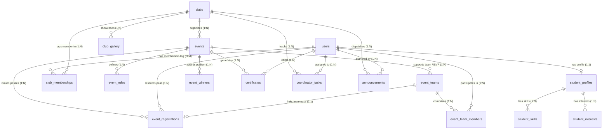

# UniSphere Database Schema Specification 🗄️
### Relational SQL Schema & Data Architecture (NAAC Criterion 5.3 Compliant)

- **Target Engine**: PostgreSQL 15+ / MySQL 8.0+
- **Character Set**: `UTF-8` (`utf8mb4` for MySQL)
- **Timezone**: UTC (`TIMESTAMP WITH TIME ZONE` / `DATETIME`)
- **Naming Convention**: `snake_case` for all table and column identifiers; plural names for tables.

---

## 1. High-Level Entity-Relationship Diagram (ERD)



---

## 2. Global Enumerations & Domain Types

### UserRole
* `GENERAL_STUDENT`: Standard student user. Can discover clubs, register for events (unless tagged as organizing club member), hold digital hall tickets, earn certificates, and manage student profile/ID card.
* `CLUB_COORDINATOR`: Student lead for one or more clubs. Has administrative console access to manage events, member tags, task checklist, announcements, and view analytics.
* `FACULTY_HEAD`: Faculty advisor overseeing club governance, approving events, and endorsing certificates.
* `ADMIN`: University system administrator with global institutional control.

### EventStage (4-Stage Lifecycle)
* `UPCOMING`: Event pre-announced; details visible, registration scheduled for future date ("Opening Soon").
* `OPEN`: Event actively accepting student RSVPs and issuing digital passes ("Open for RSVP").
* `CLOSED`: Capacity reached or registration window concluded prior to event kickoff ("Registration Closed").
* `PAST`: Event concluded; marked complete; unlocks winners podium and accredited certificates ("Concluded / Past").
* `CANCELLED`: Event formally cancelled; registered passes invalidated.

### ClubApprovalStatus (Administrative Vetting Lifecycle)
* `REQUESTED`: Initial state when a club coordinator or faculty advisor submits a registration request. The club is under institutional review by university administration.
* `APPROVED`: Officially approved by university administration. Unlocks the club for public catalog discovery, event creation, member rosters, and coordinator dashboard access.
* `REJECTED`: Rejected by university administration with a formal `rejection_reason`.

### MembershipRole & The Institutional Non-Participation Rule
* **The Membership Tag Concept**:
  * In UniSphere, adding a student to a club grants them an **organizational membership tag** (e.g., `MEMBER` or `CORE_TEAM`).
  * This tag identifies them as an affiliate/organizer of that specific club.
* **Confirmed Event Registration Restriction**:
  * **Rule**: Any student who belongs to a club (holds an active membership tag) **cannot register or participate in any of that club's events** (confirmed institutional governance policy).
  * **Rationale**: Club members form the organizing, volunteering, and execution committee of their club's events and are prohibited from taking participant seats or claiming participant credentials for their own events.
  * **Validation Rule**:
    ```sql
    -- Enforced during RSVP validation:
    SELECT COUNT(*) FROM club_memberships 
    WHERE club_id = :eventClubId AND user_id = :studentUserId AND status = 'ACTIVE';
    -- If count > 0 -> Registration blocked with 403 FORBIDDEN (CLUB_MEMBER_PARTICIPATION_PROHIBITED)
    ```
* `MEMBER`: General club member admitted via zero-code open enrollment or coordinator search tag.
* `CORE_TEAM`: Executive student committee member (e.g., *Technical Lead*, *Event Manager*, *PR Coordinator*).
* `COORDINATOR`: Head student coordinator leading the organization.
* `FACULTY_ADVISOR`: Official faculty mentor assigned by the academic department.

### TeamMemberRole (Team Registration)
* `LEAD`: Team captain who created the team and initiated the RSVP pass.
* `MEMBER`: Teammate added via student search.

### RegistrationStatus
* `CONFIRMED`: Active seat pass held by student. Entry permitted at campus security gate.
* `WAITLISTED`: Placed on overflow queue; promoted if seats open.
* `CHECKED_IN`: Verified physically present at venue via gate scanner.
* `CANCELLED`: Seat surrendered by student; seat released back to capacity pool.

### TaskPriority & Status
* Priority: `HIGH`, `MEDIUM`, `LOW`
* Status: `PENDING`, `IN_PROGRESS`, `COMPLETED`
* Category: `TECHNICAL`, `PUBLICITY`, `LOGISTICS`, `PERMISSIONS`, `GENERAL`

### AnnouncementCategory & Priority
* Category: `EVENT_ALERT`, `RECRUITMENT`, `WORKSHOP`, `GENERAL_NOTICE`
* Priority: `HIGH` (displays pulsating urgent notice badge), `NORMAL`, `LOW`
* Audience: `ALL_STUDENTS`, `CLUB_MEMBERS`, `EVENT_ATTENDEES`

---

## 3. Detailed Table Specifications

### 3.1 `users` Table
Stores fundamental identity, login authentication, and institutional role.

| Column | Data Type | Nullable | Constraints / Defaults | Description |
| :--- | :--- | :---: | :--- | :--- |
| `id` | `VARCHAR(36)` | NO | `PRIMARY KEY` (UUID) | Unique system user ID |
| `email` | `VARCHAR(255)` | NO | `UNIQUE`, `NOT NULL` | Official college email address |
| `password_hash` | `VARCHAR(255)` | NO | `NOT NULL` | Bcrypt / Argon2 hashed credentials |
| `name` | `VARCHAR(150)` | NO | `NOT NULL` | Full display name (e.g., Vikram Singh) |
| `phone` | `VARCHAR(20)` | YES | | Verified mobile contact number |
| `role` | `VARCHAR(30)` | NO | `DEFAULT 'GENERAL_STUDENT'` | Enum: `GENERAL_STUDENT`, `CLUB_COORDINATOR`, `FACULTY_HEAD`, `ADMIN` |
| `avatar_url` | `VARCHAR(500)` | YES | | Profile photo hosted URL |
| `is_active` | `BOOLEAN` | NO | `DEFAULT TRUE` | Soft-disable / active account status |
| `created_at` | `TIMESTAMP` | NO | `DEFAULT CURRENT_TIMESTAMP` | Record creation timestamp |
| `updated_at` | `TIMESTAMP` | NO | `DEFAULT CURRENT_TIMESTAMP` | Record last updated timestamp |

* **Indexes**:
  * `idx_users_email` (`email`) — Fast authentication lookup.
  * `idx_users_role` (`role`) — Filtering accounts by institutional role.

---

### 3.2 `student_profiles` Table
Stores full academic credentials and demographic records utilized in the **Student Profile** and **Virtual Campus Identity Card**.

| Column | Data Type | Nullable | Constraints / Defaults | Description |
| :--- | :--- | :---: | :--- | :--- |
| `user_id` | `VARCHAR(36)` | NO | `PRIMARY KEY`, `FK -> users(id) ON DELETE CASCADE` | 1:1 foreign key relation to users |
| `class_roll_no` | `VARCHAR(50)` | NO | `NOT NULL` | Departmental Class Roll (e.g., `CS24089`) |
| `university_roll_no` | `VARCHAR(50)` | NO | `UNIQUE`, `NOT NULL` | University Registration Number (e.g., `2400100345`) |
| `course` | `VARCHAR(50)` | NO | `DEFAULT 'B.Tech'` | Degree program (e.g., `B.Tech`, `BCA`, `MCA`, `B.Sc`) |
| `branch` | `VARCHAR(100)` | NO | `NOT NULL` | Engineering / Academic branch (e.g., `Computer Science & Engineering`) |
| `semester` | `VARCHAR(20)` | NO | `DEFAULT '4th Sem'` | Current enrolled semester (e.g., `4th Sem`) |
| `academic_year` | `VARCHAR(20)` | NO | `DEFAULT '2nd Year'` | Academic standing year (e.g., `1st Year`, `2nd Year`, `3rd Year`, `4th Year`) |
| `department` | `VARCHAR(150)` | NO | `NOT NULL` | Parent academic department (e.g., `Department of Computer Science & Engineering`) |
| `admission_year` | `INT` | NO | `DEFAULT 2024` | Cohort enrollment year |
| `graduating_year` | `INT` | NO | `DEFAULT 2028` | Expected degree conferral year |
| `blood_group` | `VARCHAR(10)` | YES | `DEFAULT 'B+'` | Blood group for campus dispensary compliance (`A+`, `B+`, `O+`, etc.) |
| `emergency_contact` | `VARCHAR(25)` | YES | | Emergency contact number (parents/guardian) |
| `bio` | `TEXT` | YES | | Personal professional summary statement |
| `github_url` | `VARCHAR(255)` | YES | | Developer portfolio link |
| `linkedin_url` | `VARCHAR(255)` | YES | | Professional networking link |
| `co_curricular_hours` | `DECIMAL(5,1)` | NO | `DEFAULT 0.0` | Accumulated verified co-curricular learning hours (e.g., `16.0`) |
| `created_at` | `TIMESTAMP` | NO | `DEFAULT CURRENT_TIMESTAMP` | Timestamp created |
| `updated_at` | `TIMESTAMP` | NO | `DEFAULT CURRENT_TIMESTAMP` | Timestamp modified |

* **Indexes**:
  * `idx_student_univ_roll` (`university_roll_no`) — Unique lookup index for hall ticket scanners.
  * `idx_student_class_roll` (`class_roll_no`) — Departmental batch search.
  * `idx_student_dept_branch` (`department`, `branch`) — NAAC departmental analytics grouping.

---

### 3.3 `student_skills` Table
Normalized technical skills associated with student profiles.

| Column | Data Type | Nullable | Constraints / Defaults | Description |
| :--- | :--- | :---: | :--- | :--- |
| `id` | `BIGINT AUTO_INCREMENT` | NO | `PRIMARY KEY` | Unique skill tag record |
| `user_id` | `VARCHAR(36)` | NO | `FK -> users(id) ON DELETE CASCADE` | Associated student user |
| `skill_name` | `VARCHAR(100)` | NO | `NOT NULL` | Skill name (e.g., `React.js`, `Python`, `Docker`) |

* **Indexes**:
  * `idx_student_skills_user` (`user_id`) — Retrieve all skills for a student.
  * `uq_student_skill` (`user_id`, `skill_name`) — Prevent duplicate skill tags.

---

### 3.4 `student_interests` Table
Normalized campus interests and extracurricular pursuits.

| Column | Data Type | Nullable | Constraints / Defaults | Description |
| :--- | :--- | :---: | :--- | :--- |
| `id` | `BIGINT AUTO_INCREMENT` | NO | `PRIMARY KEY` | Unique interest tag record |
| `user_id` | `VARCHAR(36)` | NO | `FK -> users(id) ON DELETE CASCADE` | Associated student user |
| `interest_name` | `VARCHAR(100)` | NO | `NOT NULL` | Interest (e.g., `Hackathons`, `Robotics`, `Debating`) |

* **Indexes**:
  * `uq_student_interest` (`user_id`, `interest_name`) — Unique interest tag per user.

---

### 3.5 `clubs` Table
Stores registered campus clubs, societies, faculty mentors, institutional codes, and governance.

| Column | Data Type | Nullable | Constraints / Defaults | Description |
| :--- | :--- | :---: | :--- | :--- |
| `id` | `VARCHAR(36)` | NO | `PRIMARY KEY` (e.g., `c1`) | Unique club identifier |
| `club_code` | `VARCHAR(50)` | NO | `UNIQUE`, `NOT NULL` | Official Unique Club Code (e.g., `BW-CSE-2026`) |
| `name` | `VARCHAR(150)` | NO | `NOT NULL` | Organization name (e.g., `Byte Warriors`) |
| `category` | `VARCHAR(50)` | NO | `NOT NULL` | Domain: `Computer Science`, `Engineering`, `Arts & Culture`, `Entrepreneurship` |
| `department` | `VARCHAR(150)` | NO | `NOT NULL` | Sponsoring department (e.g., `Computer Science & Engineering`) |
| `description` | `VARCHAR(300)` | NO | `NOT NULL` | Short mission summary snippet for catalog cards |
| `about_mission` | `TEXT` | YES | | Comprehensive organizational mandate & history |
| `faculty_advisor_name` | `VARCHAR(150)` | NO | `NOT NULL` | Official faculty advisor (e.g., `Dr. Sharma`) |
| `faculty_advisor_id` | `VARCHAR(36)` | YES | `FK -> users(id) ON DELETE SET NULL` | Linked faculty user account |
| `hod_name` | `VARCHAR(150)` | NO | `NOT NULL` | Head of Department endorsing club (e.g., `Dr. V. K. Mathur`) |
| `logo_url` | `VARCHAR(500)` | NO | `NOT NULL` | Emblem logo image URL |
| `banner_url` | `VARCHAR(500)` | NO | `NOT NULL` | High-resolution cover banner image URL |
| `email` | `VARCHAR(255)` | YES | | Official communication email |
| `phone` | `VARCHAR(25)` | YES | | Secretarial contact telephone |
| `website_url` | `VARCHAR(255)` | YES | | Club external website |
| `instagram_url` | `VARCHAR(255)` | YES | | Instagram handle / URL |
| `linkedin_url` | `VARCHAR(255)` | YES | | LinkedIn company page URL |
| `discord_url` | `VARCHAR(255)` | YES | | Student community chat room |
| `github_url` | `VARCHAR(255)` | YES | | Open source repositories URL |
| `founded_year` | `INT` | NO | `DEFAULT 2021` | Founding academic session |
| `approval_status` | `VARCHAR(20)` | NO | `DEFAULT 'requested'`, `CHECK (approval_status IN ('requested', 'approved', 'rejected'))` | Administrative vetting status: `requested` (initial submission), `approved` (admin cleared), `rejected` (admin declined) |
| `rejection_reason` | `TEXT` | YES | | Official feedback specifying reason if rejected by administrator |
| `approved_by` | `VARCHAR(36)` | YES | `FK -> users(id) ON DELETE SET NULL` | System administrator user who approved/rejected the registration |
| `approved_at` | `TIMESTAMP` | YES | | Timestamp when administrator reviewed and acted on the request |
| `status` | `VARCHAR(20)` | NO | `DEFAULT 'ACTIVE'` | Operational status: `ACTIVE`, `PROBATION`, `INACTIVE` |
| `created_at` | `TIMESTAMP` | NO | `DEFAULT CURRENT_TIMESTAMP` | Record creation timestamp |
| `updated_at` | `TIMESTAMP` | NO | `DEFAULT CURRENT_TIMESTAMP` | Record last updated timestamp |

* **Indexes**:
  * `idx_clubs_approval_status` (`approval_status`) — Fast administrative queue queries (`approval_status = 'requested'`) and student catalog filtering (`approval_status = 'approved'`).
  * `idx_clubs_code` (`club_code`) — Quick lookup for verified code copy.
  * `idx_clubs_category` (`category`) — Category filter pills in Explore Clubs.
  * `idx_clubs_department` (`department`) — Departmental categorization.

---

### 3.6 `club_memberships` Table
Implements **Club Membership Tags** and **Zero-Code Open Admissions**.
When a club coordinator adds a student (or a student self-enrolls), this table assigns a **membership tag**. Holding this tag marks the student as an affiliate of the organizing club, which automatically activates the **Confirmed Event Registration Restriction**: students holding a membership in a club **cannot register or participate in any of that club's events** (confirmed institutional rule with no optional bypass).

| Column | Data Type | Nullable | Constraints / Defaults | Description |
| :--- | :--- | :---: | :--- | :--- |
| `id` | `BIGINT AUTO_INCREMENT` | NO | `PRIMARY KEY` | Unique membership record |
| `club_id` | `VARCHAR(36)` | NO | `FK -> clubs(id) ON DELETE CASCADE` | Associated campus club |
| `user_id` | `VARCHAR(36)` | NO | `FK -> users(id) ON DELETE CASCADE` | Enrolled student user |
| `role` | `VARCHAR(30)` | NO | `DEFAULT 'MEMBER'` | Membership Tier: `MEMBER`, `CORE_TEAM`, `COORDINATOR`, `LEAD` |
| `designation` | `VARCHAR(100)` | NO | `DEFAULT 'General Member'` | Specific post (e.g., `Technical Lead`, `Event Manager`, `General Member`) |
| `joined_date` | `DATE` | NO | `DEFAULT (CURRENT_DATE)` | Date of membership tag assignment |
| `status` | `VARCHAR(20)` | NO | `DEFAULT 'ACTIVE'` | `ACTIVE`, `ALUMNI`, `SUSPENDED` |
| `created_at` | `TIMESTAMP` | NO | `DEFAULT CURRENT_TIMESTAMP` | Record timestamp |

* **Indexes**:
  * `uq_club_user_membership` (`club_id`, `user_id`) — **UNIQUE constraint** ensuring a student has only one active membership tag per club.
  * `idx_membership_club_role` (`club_id`, `role`) — Fast filter between Core Executive Team and General Members.
  * `idx_membership_user_status` (`user_id`, `status`) — Instant check during event RSVP to block members from registering for their own club's events.

---

### 3.7 `club_gallery` Table
Showcases club photos, past event captures, and workshops on public club profiles.

| Column | Data Type | Nullable | Constraints / Defaults | Description |
| :--- | :--- | :---: | :--- | :--- |
| `id` | `BIGINT AUTO_INCREMENT` | NO | `PRIMARY KEY` | Gallery asset identifier |
| `club_id` | `VARCHAR(36)` | NO | `FK -> clubs(id) ON DELETE CASCADE` | Associated club |
| `image_url` | `VARCHAR(500)` | NO | `NOT NULL` | Hosted photo asset URL |
| `caption` | `VARCHAR(255)` | YES | | Short photo caption or event context |
| `uploaded_at` | `TIMESTAMP` | NO | `DEFAULT CURRENT_TIMESTAMP` | Timestamp |

---

### 3.8 `events` Table
Implements the **4-Stage Event Lifecycle Architecture**, **Club Member Registration Restrictions**, and **Team Event Configurations**.

| Column | Data Type | Nullable | Constraints / Defaults | Description |
| :--- | :--- | :---: | :--- | :--- |
| `id` | `VARCHAR(36)` | NO | `PRIMARY KEY` (e.g., `e1`) | Unique event identifier |
| `club_id` | `VARCHAR(36)` | NO | `FK -> clubs(id) ON DELETE CASCADE` | Organizing club |
| `title` | `VARCHAR(200)` | NO | `NOT NULL` | Event title (e.g., `Campus Hackathon 2026`) |
| `category` | `VARCHAR(50)` | NO | `NOT NULL` | Domain: `Technical`, `Hackathon`, `Workshop`, `Cultural`, `Competitions`, `Webinar` |
| `stage` | `VARCHAR(20)` | NO | `DEFAULT 'upcoming'` | 4-Stage State Machine: `upcoming`, `open`, `closed`, `past` |
| `status` | `VARCHAR(20)` | NO | `DEFAULT 'Upcoming'` | Presentation status: `Upcoming`, `Open`, `Closed`, `Past`, `Cancelled` |
| `restrict_club_members`| `BOOLEAN` | NO | `DEFAULT TRUE` | **If TRUE, students holding a membership tag in this club CANNOT register as participants** |
| `is_team_event` | `BOOLEAN` | NO | `DEFAULT FALSE` | Enables team registration and teammate search in RSVP modal |
| `min_team_size` | `INT` | NO | `DEFAULT 1` | Minimum members per team (e.g., 2 for Hackathons) |
| `max_team_size` | `INT` | NO | `DEFAULT 4` | Maximum members permitted per team |
| `event_date` | `DATE` | NO | `NOT NULL` | Date of scheduled session (e.g., `2026-10-24`) |
| `start_time` | `VARCHAR(20)` | NO | `NOT NULL` | Start time (e.g., `09:00 AM`) |
| `end_time` | `VARCHAR(20)` | NO | `NOT NULL` | End time (e.g., `05:00 PM`) |
| `time_display` | `VARCHAR(50)` | NO | `NOT NULL` | Formatted display time (e.g., `09:00 AM - 05:00 PM`) |
| `venue` | `VARCHAR(150)` | NO | `NOT NULL` | Physical campus location (e.g., `Main Auditorium & CS Labs`) |
| `venue_room` | `VARCHAR(50)` | YES | | Room number or lab wing (e.g., `Lab 3B`, `Hall A`) |
| `capacity` | `INT` | NO | `NOT NULL` | Maximum permitted seat count (e.g., `200`) |
| `registered_count` | `INT` | NO | `DEFAULT 0` | Denormalized / cached count of reserved passes |
| `turnout_count` | `INT` | NO | `DEFAULT 0` | Physical attendees checked in at security gate |
| `description` | `TEXT` | NO | `NOT NULL` | Comprehensive event narrative, schedule, and tracks |
| `eligibility` | `VARCHAR(255)` | NO | `DEFAULT 'All Students'` | Student eligibility criteria |
| `image_url` | `VARCHAR(500)` | NO | `NOT NULL` | Event cover artwork URL |
| `registration_opens_at`| `DATE` | YES | | Date when registrations automatically unlock |
| `registration_closes_at`|`DATE` | YES | | Date when registration window shuts |
| `created_by` | `VARCHAR(36)` | YES | `FK -> users(id) ON DELETE SET NULL` | Coordinator user who created event |
| `created_at` | `TIMESTAMP` | NO | `DEFAULT CURRENT_TIMESTAMP` | Timestamp |
| `updated_at` | `TIMESTAMP` | NO | `DEFAULT CURRENT_TIMESTAMP` | Timestamp |

* **Indexes**:
  * `idx_events_stage_date` (`stage`, `event_date`) — Filtering discovery tabs (*Open for RSVP*, *Opening Soon*, *Past & Winners*).
  * `idx_events_club_id` (`club_id`) — Club dashboard scheduled events.
  * `idx_events_category` (`category`) — Category filtering.

---

### 3.9 `event_rules` Table
Stores institutional and contest rules enforced for each campus activity.

| Column | Data Type | Nullable | Constraints / Defaults | Description |
| :--- | :--- | :---: | :--- | :--- |
| `id` | `BIGINT AUTO_INCREMENT` | NO | `PRIMARY KEY` | Rule identifier |
| `event_id` | `VARCHAR(36)` | NO | `FK -> events(id) ON DELETE CASCADE` | Associated event |
| `rule_order` | `INT` | NO | `DEFAULT 1` | Display order sequence (1, 2, 3...) |
| `rule_text` | `VARCHAR(500)` | NO | `NOT NULL` | Text rule (e.g., `Teams of 2-4 members allowed`, `Bring college ID card`) |

---

### 3.10 `event_registrations` Table
Stores individual or team student passes, digital barcodes, seat IDs, and physical gate check-in status.

| Column | Data Type | Nullable | Constraints / Defaults | Description |
| :--- | :--- | :---: | :--- | :--- |
| `id` | `BIGINT AUTO_INCREMENT` | NO | `PRIMARY KEY` | Unique registration record |
| `pass_code` | `VARCHAR(50)` | NO | `UNIQUE`, `NOT NULL` | Digital Hall Ticket barcode string (e.g., `PASS-E1-2026-CS24089`) |
| `event_id` | `VARCHAR(36)` | NO | `FK -> events(id) ON DELETE CASCADE` | Target event |
| `user_id` | `VARCHAR(36)` | NO | `FK -> users(id) ON DELETE CASCADE` | Registered student user |
| `team_id` | `BIGINT` | YES | `FK -> event_teams(id) ON DELETE SET NULL` | Linked team entry (if team event) |
| `is_team_lead` | `BOOLEAN` | NO | `DEFAULT FALSE` | True if this attendee is team captain |
| `status` | `VARCHAR(20)` | NO | `DEFAULT 'CONFIRMED'` | `CONFIRMED`, `WAITLISTED`, `CHECKED_IN`, `CANCELLED` |
| `registered_at` | `TIMESTAMP` | NO | `DEFAULT CURRENT_TIMESTAMP` | Timestamp of reservation |
| `checked_in_at` | `TIMESTAMP` | YES | | Timestamp of physical barcode scan at gate |
| `cancelled_at` | `TIMESTAMP` | YES | | Timestamp when seat was released |

* **Indexes**:
  * `uq_event_user_registration` (`event_id`, `user_id`) — **UNIQUE constraint** guaranteeing one pass per student per event.
  * `idx_reg_user_status` (`user_id`, `status`) — Fetches active passes for `MyRegistrations.jsx` and `StudentDashboard.jsx`.
  * `idx_reg_pass_code` (`pass_code`) — Gate check-in verification scanner.
  * `idx_reg_team` (`team_id`) — Retrieve all registrations for a team.

---

### 3.10b `event_teams` Table
Stores registered teams for hackathons, coding contests, and team-based campus competitions.

| Column | Data Type | Nullable | Constraints / Defaults | Description |
| :--- | :--- | :---: | :--- | :--- |
| `id` | `BIGINT AUTO_INCREMENT` | NO | `PRIMARY KEY` | Team identifier |
| `event_id` | `VARCHAR(36)` | NO | `FK -> events(id) ON DELETE CASCADE` | Associated team event |
| `team_name` | `VARCHAR(150)` | NO | `NOT NULL` | Team name (e.g., `CodeCrafters`) |
| `team_lead_user_id` | `VARCHAR(36)` | NO | `FK -> users(id) ON DELETE CASCADE` | Captain / Student who registered team |
| `pass_code` | `VARCHAR(50)` | NO | `UNIQUE`, `NOT NULL` | Group pass code (e.g., `TEAM-E1-CODECRAFTERS-2026`) |
| `status` | `VARCHAR(20)` | NO | `DEFAULT 'CONFIRMED'` | `CONFIRMED`, `WAITLISTED`, `CANCELLED` |
| `created_at` | `TIMESTAMP` | NO | `DEFAULT CURRENT_TIMESTAMP` | Registration timestamp |

* **Indexes**:
  * `uq_event_team_name` (`event_id`, `team_name`) — Prevents duplicate team names within the same event.
  * `idx_event_teams_event` (`event_id`) — List all teams for an event.

---

### 3.10c `event_team_members` Table
Stores members selected for each team via the **Student Search** autocomplete interface.

| Column | Data Type | Nullable | Constraints / Defaults | Description |
| :--- | :--- | :---: | :--- | :--- |
| `id` | `BIGINT AUTO_INCREMENT` | NO | `PRIMARY KEY` | Team member record |
| `team_id` | `BIGINT` | NO | `FK -> event_teams(id) ON DELETE CASCADE` | Associated team |
| `user_id` | `VARCHAR(36)` | NO | `FK -> users(id) ON DELETE CASCADE` | Student teammate |
| `role` | `VARCHAR(20)` | NO | `DEFAULT 'MEMBER'` | `LEAD` or `MEMBER` |
| `joined_at` | `TIMESTAMP` | NO | `DEFAULT CURRENT_TIMESTAMP` | Timestamp added |

* **Indexes**:
  * `uq_team_user` (`team_id`, `user_id`) — Prevents adding the same student twice to the same team.
  * `idx_team_members_user` (`user_id`) — Quick lookup of a student's team memberships.

---

### 3.11 `event_winners` Table
Showcases the **Champions & Winners Podium** for concluded hackathons and competitions with medals and cash awards.

| Column | Data Type | Nullable | Constraints / Defaults | Description |
| :--- | :--- | :---: | :--- | :--- |
| `id` | `BIGINT AUTO_INCREMENT` | NO | `PRIMARY KEY` | Winner record identifier |
| `event_id` | `VARCHAR(36)` | NO | `FK -> events(id) ON DELETE CASCADE` | Associated concluded event |
| `rank_position` | `INT` | NO | `NOT NULL` | Podium position: `1` (1st), `2` (2nd), `3` (3rd), `4` (Special Mention) |
| `rank_display` | `VARCHAR(30)` | NO | `NOT NULL` | Formatted rank (e.g., `1st Place`, `2nd Place`, `3rd Place`) |
| `winner_name` | `VARCHAR(150)` | NO | `NOT NULL` | Individual or Team champion name (e.g., `Siddharth Varma`) |
| `user_id` | `VARCHAR(36)` | YES | `FK -> users(id) ON DELETE SET NULL` | Student user account (if enrolled student) |
| `branch` | `VARCHAR(100)` | NO | `NOT NULL` | Academic branch & standing (e.g., `CSE 4th Year`) |
| `prize` | `VARCHAR(100)` | NO | `NOT NULL` | Reward awarded (e.g., `₹12,000 + Merit Medal`) |
| `project_title` | `VARCHAR(200)` | YES | | Winning project title (e.g., `AI Diagnostics Engine`) |
| `declared_at` | `TIMESTAMP` | NO | `DEFAULT CURRENT_TIMESTAMP` | Declaration timestamp |

* **Indexes**:
  * `idx_winners_event` (`event_id`, `rank_position`) — Fast ordering of champions podium.

---

### 3.12 `certificates` Table
Stores officially accredited **NAAC Criterion 5.3 Institutional Certificates of Completion** with digital cryptographic credential IDs and faculty signatures.

| Column | Data Type | Nullable | Constraints / Defaults | Description |
| :--- | :--- | :---: | :--- | :--- |
| `id` | `VARCHAR(36)` | NO | `PRIMARY KEY` (UUID) | Certificate internal record ID |
| `credential_id` | `VARCHAR(80)` | NO | `UNIQUE`, `NOT NULL` | Publicly verifiable Credential ID (e.g., `UNIS-CERT-E2-2025-CS24089`) |
| `event_id` | `VARCHAR(36)` | NO | `FK -> events(id) ON DELETE RESTRICT` | Associated completed event |
| `user_id` | `VARCHAR(36)` | NO | `FK -> users(id) ON DELETE CASCADE` | Certified student recipient |
| `type` | `VARCHAR(30)` | NO | `DEFAULT 'COMPLETION'` | Type: `COMPLETION`, `MERIT_WINNER`, `APPRECIATION`, `ORGANIZER` |
| `student_name` | `VARCHAR(150)` | NO | `NOT NULL` | Snapshot of recipient name at issuance |
| `class_roll_no` | `VARCHAR(50)` | NO | `NOT NULL` | Snapshot of class roll number |
| `course_branch` | `VARCHAR(150)` | NO | `NOT NULL` | Snapshot of degree & branch (e.g., `B.Tech in CSE`) |
| `event_title` | `VARCHAR(200)` | NO | `NOT NULL` | Snapshot of event title |
| `club_name` | `VARCHAR(150)` | NO | `NOT NULL` | Snapshot of organizing club |
| `faculty_advisor_name` | `VARCHAR(150)` | NO | `NOT NULL` | Endorsing Faculty Advisor (e.g., `Dr. Sharma`) |
| `hod_name` | `VARCHAR(150)` | NO | `NOT NULL` | Endorsing Head of Department (e.g., `Dr. V. K. Mathur`) |
| `issue_date` | `DATE` | NO | `NOT NULL` | Official date of issuance |
| `naac_criterion` | `VARCHAR(20)` | NO | `DEFAULT '5.3'` | NAAC Accreditation Criterion code |
| `pdf_url` | `VARCHAR(500)` | YES | | Pre-rendered PDF asset link (if stored on S3/GCS) |
| `status` | `VARCHAR(20)` | NO | `DEFAULT 'ISSUED'` | Status: `ISSUED`, `REVOKED` |
| `created_at` | `TIMESTAMP` | NO | `DEFAULT CURRENT_TIMESTAMP` | Record timestamp |

* **Indexes**:
  * `idx_cert_credential_id` (`credential_id`) — Instant public verification lookup.
  * `idx_cert_user_id` (`user_id`) — Displays student credentials on MyRegistrations and Profile.

---

### 3.13 `coordinator_tasks` Table
Powers the **Operational Task Checklist** for club coordinators with priority tags, categories, and due dates.

| Column | Data Type | Nullable | Constraints / Defaults | Description |
| :--- | :--- | :---: | :--- | :--- |
| `id` | `VARCHAR(36)` | NO | `PRIMARY KEY` (e.g., `t1`) | Unique task identifier |
| `club_id` | `VARCHAR(36)` | NO | `FK -> clubs(id) ON DELETE CASCADE` | Associated club |
| `title` | `VARCHAR(200)` | NO | `NOT NULL` | Task objective (e.g., `Finalize Guest Speaker`) |
| `description` | `TEXT` | YES | | Detailed instructions and deliverables |
| `category` | `VARCHAR(30)` | NO | `DEFAULT 'General'` | `Technical`, `Publicity`, `Logistics`, `Permissions`, `General` |
| `priority` | `VARCHAR(20)` | NO | `DEFAULT 'Medium'` | Priority: `High`, `Medium`, `Low` |
| `assignee` | `VARCHAR(150)` | NO | `NOT NULL` | Name and role of assigned coordinator |
| `assigned_user_id` | `VARCHAR(36)` | YES | `FK -> users(id) ON DELETE SET NULL` | Linked coordinator user account |
| `due_date` | `DATE` | NO | `NOT NULL` | Target completion deadline |
| `status` | `VARCHAR(20)` | NO | `DEFAULT 'pending'` | Status: `pending`, `in_progress`, `completed` |
| `completed_at` | `TIMESTAMP` | YES | | Date-time when task was checked off |
| `created_by` | `VARCHAR(36)` | YES | `FK -> users(id) ON DELETE SET NULL` | Task creator user |
| `created_at` | `TIMESTAMP` | NO | `DEFAULT CURRENT_TIMESTAMP` | Timestamp |
| `updated_at` | `TIMESTAMP` | NO | `DEFAULT CURRENT_TIMESTAMP` | Timestamp |

* **Indexes**:
  * `idx_tasks_club_status` (`club_id`, `status`) — Filters active vs completed tasks on dashboard.
  * `idx_tasks_due_date` (`due_date`) — Chronological deadline tracking.

---

### 3.14 `announcements` Table
Powers the **Campus Bulletins & Notices Feed** with urgency flags, category badges, and target audience restrictions.

| Column | Data Type | Nullable | Constraints / Defaults | Description |
| :--- | :--- | :---: | :--- | :--- |
| `id` | `VARCHAR(36)` | NO | `PRIMARY KEY` (e.g., `a1`) | Notice identifier |
| `club_id` | `VARCHAR(36)` | NO | `FK -> clubs(id) ON DELETE CASCADE` | Sponsoring club |
| `title` | `VARCHAR(250)` | NO | `NOT NULL` | Notice headline |
| `content` | `TEXT` | NO | `NOT NULL` | Full dispatch message body |
| `category` | `VARCHAR(30)` | NO | `DEFAULT 'General Notice'` | `Event Alert`, `Recruitment`, `Workshop`, `General Notice` |
| `priority` | `VARCHAR(20)` | NO | `DEFAULT 'Normal'` | Priority: `High` (Urgent), `Normal`, `Low` |
| `audience` | `VARCHAR(50)` | NO | `DEFAULT 'All Campus Students'` | `All Campus Students`, `Club Members Only`, `Event Attendees` |
| `author` | `VARCHAR(150)` | NO | `NOT NULL` | Signatory (e.g., `Dr. Sharma (Faculty Advisor)`) |
| `author_user_id` | `VARCHAR(36)` | YES | `FK -> users(id) ON DELETE SET NULL` | Author user account |
| `publish_date` | `DATE` | NO | `DEFAULT (CURRENT_DATE)` | Display date |
| `is_pinned` | `BOOLEAN` | NO | `DEFAULT FALSE` | Pin to top of bulletins feed |
| `created_at` | `TIMESTAMP` | NO | `DEFAULT CURRENT_TIMESTAMP` | Timestamp |
| `updated_at` | `TIMESTAMP` | NO | `DEFAULT CURRENT_TIMESTAMP` | Timestamp |

* **Indexes**:
  * `idx_announcements_club` (`club_id`, `publish_date`) — Club profile notices tab.
  * `idx_announcements_feed` (`priority`, `publish_date`) — Student dashboard live bulletins feed.

---

## 4. Student Search & Directory Autocomplete Architecture 🔍

To support the **Student Search** interface required when:
1. A **Club Coordinator** enrolls a student and searches by name or roll number with instant suggestions displayed beneath the input field.
2. A **Student** registers for team events (Hackathons, competitions) and searches for teammates to add to their roster.

The database must support low-latency prefix and trigram matching across student identity tables:

### 4.1 Indexing Strategy
```sql
-- PostgreSQL Trigram / Prefix Indexes (via pg_trgm extension):
CREATE EXTENSION IF NOT EXISTS pg_trgm;

CREATE INDEX idx_student_search_name ON users USING gin (name gin_trgm_ops);
CREATE INDEX idx_student_search_email ON users USING gin (email gin_trgm_ops);
CREATE INDEX idx_student_search_class_roll ON student_profiles USING gin (class_roll_no gin_trgm_ops);
CREATE INDEX idx_student_search_univ_roll ON student_profiles USING gin (university_roll_no gin_trgm_ops);

-- MySQL 8.0 Fulltext Alternatives:
-- ALTER TABLE users ADD FULLTEXT(name, email);
-- ALTER TABLE student_profiles ADD FULLTEXT(class_roll_no, university_roll_no);
```

### 4.2 Optimized Search Query
```sql
-- Autocomplete Query used by GET /api/v1/students/search:
SELECT 
    u.id,
    u.name,
    u.email,
    u.avatar_url,
    sp.class_roll_no,
    sp.university_roll_no,
    sp.course,
    sp.branch,
    sp.semester,
    sp.academic_year,
    sp.department,
    -- Check if student already holds a membership tag in this club:
    CASE 
        WHEN :clubId IS NOT NULL AND EXISTS (
            SELECT 1 FROM club_memberships cm 
            WHERE cm.club_id = :clubId AND cm.user_id = u.id AND cm.status = 'ACTIVE'
        ) THEN TRUE 
        ELSE FALSE 
    END AS is_club_member,
    -- Check if student is already registered for this event:
    CASE 
        WHEN :eventId IS NOT NULL AND EXISTS (
            SELECT 1 FROM event_registrations er 
            WHERE er.event_id = :eventId AND er.user_id = u.id AND er.status != 'CANCELLED'
        ) THEN TRUE 
        ELSE FALSE 
    END AS is_already_registered
FROM users u
JOIN student_profiles sp ON u.id = sp.user_id
WHERE u.role = 'GENERAL_STUDENT'
  AND u.is_active = TRUE
  AND (
      u.name ILIKE CONCAT('%', :query, '%')
      OR sp.class_roll_no ILIKE CONCAT('%', :query, '%')
      OR sp.university_roll_no ILIKE CONCAT('%', :query, '%')
      OR u.email ILIKE CONCAT('%', :query, '%')
  )
ORDER BY 
    CASE WHEN sp.class_roll_no ILIKE CONCAT(:query, '%') THEN 1 ELSE 2 END,
    u.name ASC
LIMIT 10;
```

---

## 5. Institutional Audit View (NAAC Criterion 5.3 Ready)

To generate the **Departmental NAAC / IQAC Accreditation Audit Table** dynamically without heavy query joining on every request, the backend should expose this pre-indexed SQL view:

```sql
CREATE OR REPLACE VIEW view_naac_event_audits AS
SELECT 
    e.id AS event_id,
    e.club_id,
    c.name AS club_name,
    c.department,
    c.faculty_advisor_name,
    c.hod_name,
    e.title AS event_title,
    e.category,
    e.venue,
    e.event_date,
    e.capacity,
    COALESCE(COUNT(DISTINCT r.id) FILTER (WHERE r.status != 'CANCELLED'), e.registered_count) AS total_registrations,
    COALESCE(COUNT(DISTINCT r.id) FILTER (WHERE r.status = 'CHECKED_IN'), e.turnout_count) AS physical_turnout,
    ROUND(
        CASE 
            WHEN e.capacity > 0 THEN 
                (COALESCE(COUNT(DISTINCT r.id) FILTER (WHERE r.status = 'CHECKED_IN'), e.turnout_count)::numeric / e.capacity::numeric) * 100 
            ELSE 0 
        END, 1
    ) AS turnout_percentage,
    CASE 
        WHEN EXISTS (SELECT 1 FROM event_winners w WHERE w.event_id = e.id) THEN TRUE 
        ELSE FALSE 
    END AS winners_declared,
    'Verified by Faculty Advisor' AS faculty_clearance_status
FROM events e
JOIN clubs c ON e.club_id = c.id
LEFT JOIN event_registrations r ON e.id = r.event_id
WHERE e.stage = 'past' OR e.status = 'Past'
GROUP BY e.id, c.id;
```

---

## 6. Seed Reference Data (Initial Campus State)

The initial seed records directly match the verified frontend demo datasets:

### Users & Authentication
* `u1`: Maan Saab (`coordinator@college.edu`, Role: `CLUB_COORDINATOR`, Managed Club: `c1`)
* `u5`: Vikram Singh (`vikram.singh@college.edu`, Role: `GENERAL_STUDENT`, Roll: `CS24089`, Univ Reg: `2400100345`)

### Clubs
* `c1`: **Byte Warriors** (`BW-CSE-2026`, Computer Science, Advisor: Dr. Sharma, HOD: Dr. V. K. Mathur)
* `c2`: **Robotics Society** (`RS-ENG-2026`, Engineering, Advisor: Prof. Mehta)
* `c3`: **Literary Club** (`LC-ART-2026`, Arts & Culture, Advisor: Dr. Iyer)
* `c4`: **E-Cell** (`EC-ENT-2026`, Entrepreneurship, Advisor: Prof. Desai)

### Events
* `e1`: **Campus Hackathon 2026** (Byte Warriors, Date: 2026-10-24, Stage: `open`, Capacity: 200, Venue: Main Auditorium)
* `e2`: **Algorithm Arena 2025** (Byte Warriors, Date: 2025-11-20, Stage: `past`, Capacity: 120, Turnout: 115, Winners declared)
* `e3`: **Line Follower Robot Challenge** (Robotics Society, Date: 2026-10-05, Stage: `open`, Capacity: 40)
